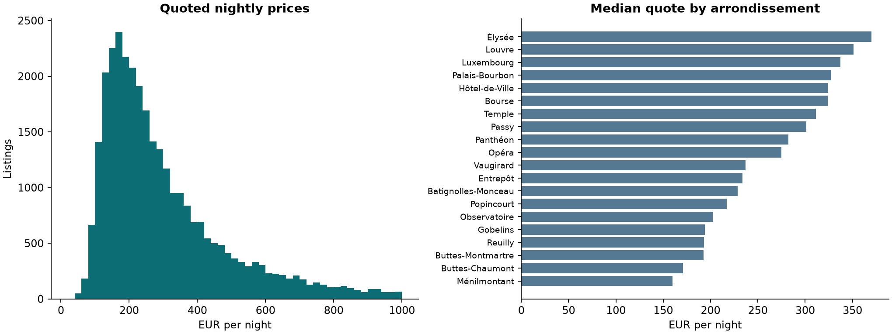
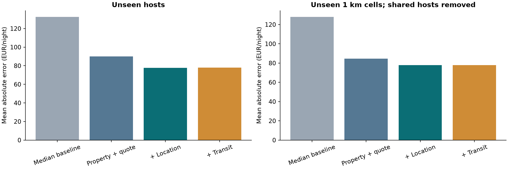
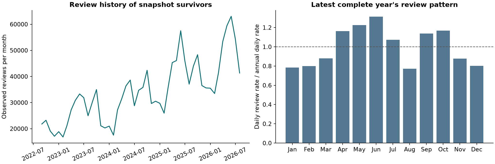
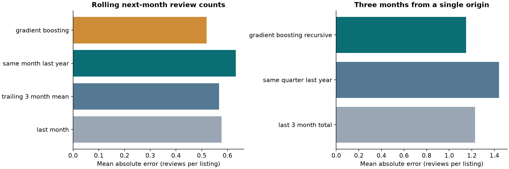
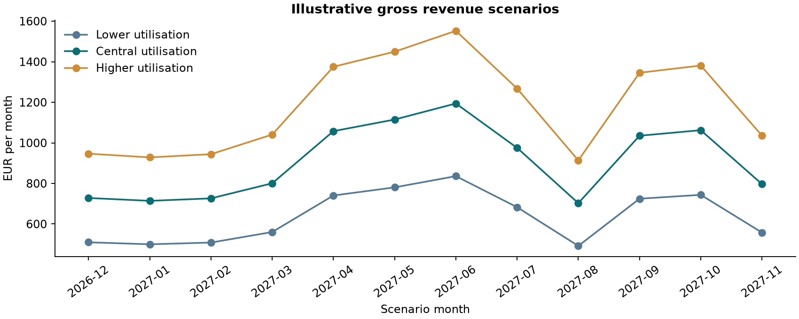
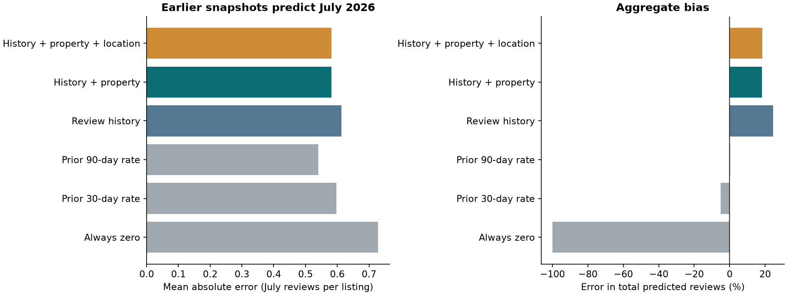

# Paris Airbnb revenue potential

Research report · Updated 11 November 2026 · Preliminary empirical results

## Abstract

This project examines how far public listing, review and transport data can support a Paris host's earnings assessment. It uses 77,149 listings and 2,503,875 raw review records supplied in the Airbnb_2 folder. The study also adds three earlier listing/review snapshots and the September calendar. Three components keep the evidence distinct: quoted-price prediction, review-activity forecasting and conditional revenue scenarios.

The location price model achieves a held-out mean absolute error of **EUR 77.72 per night** and a log-price R² of **0.655** on unseen hosts. Transport-station features do not improve materially on location alone. In the retrospective survivor cohort, a monthly review model reduces error by **8.6%** relative to a trailing-three-month baseline, but overpredicts total reviews by **9.0%**. A separate earlier-snapshot experiment predicts July reviews: the simple 90-day review-rate baseline has MAE **0.5403**, compared with **0.5820** for boosting with history, property and location. The simpler baseline also has much smaller total bias (**+0.26%** versus **+18.51%**). The earlier improvement therefore does not generalize automatically to the stronger temporal design. Actual host revenue is unavailable, so the earnings component is a scenario calculator with visible assumptions. Its outputs have not been validated against actual income.

## 1. Research questions and scope

- Does adding location improve quoted-price predictions beyond property characteristics and quote context?
- Do official transport-access variables add predictive information beyond coordinates and arrondissement?
- Can earlier review counts predict next-month and next-quarter observed review activity?
- What monthly, quarterly and annual gross revenue follows from an explicit opening plan, price benchmark and occupancy assumption?

The price model covers short-stay entire homes with an observed EUR quote from 20 to 1,000. The original rolling review experiment covers established listings of all room types that survived into September 2026. The added earlier-snapshot experiment covers source listings of all room types observed again at follow-up, including listings with no earlier reviews. These are different populations and different prediction tasks. The review model is not directly converted into booking probabilities or revenue. Cold-start demand, exits, actual occupancy and optimal pricing remain outside the validated scope.

## 2. Data audit

| Measure | Observed value |
| --- | --- |
| Listings | 77,149 |
| Raw review records | 2,503,875 |
| Collection window | 2026-09-17 to 2026-09-24 |
| Listings with missing price | 33,612 (43.6%) |
| Clean review records | 2,461,528 |
| Last complete review month | August 2026 |
| Price modelling sample | 31,044 entire homes |
| Median price in modelling sample | EUR 244 per quoted night |

All listing IDs are unique and every raw review record maps to a supplied listing. There are **13,241 review IDs associated with multiple listings**, affecting **42,347 rows (1.69%)**. Their allocation is ambiguous; the primary analysis excludes all affected rows rather than assigning them to one listing. No additional exact within-listing duplicates or reviews after their own listing's scrape date remain. This policy may undercount activity for affected properties; a future sensitivity analysis should compare alternative defensible allocation rules.

The raw quotes explicitly identify EUR. The export's dollar symbol is formatting, consistent with the Inside Airbnb dictionary. The prices refer to stays with differing check-in dates and lengths, including dates after collection. The model therefore includes quote month, lead time and stay length. These are quotes observable at collection, not subsequently realized revenue.

Missing prices affect 43.6% of listings. They are excluded from supervised price fitting, not filled with zero. This selection can favour properties with available quotes; no inference is made about all Paris homes. The EUR 20–1,000 band is an analyst-defined focus on ordinary quotes, not an assertion that excluded prices are errors. Results do not describe the luxury tail.

| Selection step | Listings |
| --- | --- |
| All supplied listings | 77149 |
| Entire homes | 68333 |
| Minimum stay of 1–29 nights | 53472 |
| Observed EUR quote | 32415 |
| Quote between EUR 20 and 1,000 | 31044 |
| Final modelling sample | 31044 |

## 3. Quoted-price prediction

### Features and model

The internal specification uses capacity, bedrooms, beds, bathrooms, minimum stay, amenities count, five amenity indicators and quote context. The location specification adds latitude, longitude and arrondissement. The transit specification adds distance to the nearest metro and RER station plus metro-station counts within 500 and 1,000 metres. Listing/host IDs, review ratings, review totals, availability and estimated revenue are not predictors.

Official Île-de-France Mobilités data were retrieved on 10 November 2026. The generalized station file contains 1,002 records. Four Métro 18 records were excluded because that addition postdates the Airbnb snapshot, leaving 998 unique station records; 321 serve metro and 239 serve RER. Distances are straight-line haversine distances, not walking times. The contemporary station file is not a fully archived September vintage, so historical alignment remains approximate. Airbnb coordinate anonymization also limits fine distance precision. [Station source](https://data.iledefrance-mobilites.fr/explore/dataset/emplacement-des-gares-idf-data-generalisee/) and [coordinate limitations](https://insideairbnb.com/data-assumptions/).

All three specifications use histogram gradient boosting on log price: 220 iterations, learning rate 0.06, maximum 20 leaves, minimum 30 observations per leaf, L2 penalty 4 and seed 42. Categorical encoding is fitted inside each training split; missing numeric features are handled by the estimator. Exponentiating a log-price prediction gives a price benchmark, not an unbiased expected transaction price. A training-sample median is the simple baseline.

### Evaluation and findings

The first split holds out 20% of hosts. The second holds out approximately 1 km map cells and removes test hosts from training. The spatial split is a dispersed-cell holdout without a buffer; it does not establish performance in a completely separate city. Both protocols use one fixed seed and should be treated as exploratory comparisons. The supplied prototype uses the location specification; a new independent evaluation is needed after choosing a deployment model.

| Test | Features/model | Test rows | MAE EUR | RMSE EUR | R² log price |
| --- | --- | --- | --- | --- | --- |
| Unseen hosts | Median baseline | 6223 | 132.631 | 192.930 | -0.006 |
| Unseen hosts | Property + quote | 6223 | 90.000 | 134.812 | 0.537 |
| Unseen hosts | + Location | 6223 | 77.722 | 119.992 | 0.655 |
| Unseen hosts | + Transit | 6223 | 77.871 | 120.256 | 0.654 |
| Unseen map cells | Median baseline | 7002 | 128.037 | 191.262 | -0.036 |
| Unseen map cells | Property + quote | 7002 | 84.603 | 127.013 | 0.561 |
| Unseen map cells | + Location | 7002 | 77.861 | 117.707 | 0.635 |
| Unseen map cells | + Transit | 7002 | 77.882 | 117.737 | 0.635 |

Adding location reduces host-holdout MAE by EUR 12.28, or 13.6%, from EUR 90.00 to EUR 77.72. Its paired host-cluster bootstrap 95% interval for the MAE reduction is EUR 10.73–13.92. The spatial reduction is EUR 6.74 (interval EUR 4.84–8.65). These intervals use 400 resamples and hold the trained model fixed; they do not include retraining variability or all spatial dependence.

Transit additions change host-holdout MAE by a reduction of **EUR −0.15** (interval −0.39 to 0.09) and spatial-holdout MAE by **EUR −0.02** (interval −0.27 to 0.29). Negative reductions indicate slightly worse error. Both intervals include zero. This experiment provides no evidence of useful additional predictive gain from these particular station features. It does not establish that transport has no economic relationship with prices.

## 4. Monthly and quarterly review activity

### Temporal construction

A seeded sample of 12,000 listings was drawn from 41,983 current-snapshot listings with at least one review before September 2024. The resulting panel has 288,000 listing-month rows. It uses only review-derived features: lags of 1, 2, 3, 6 and 12 months; trailing means; the number of recently active months; months since first review; and month-of-year sine/cosine. A zero denotes no recorded reviews in that cell, not no bookings, no availability or no revenue.

Training targets span September 2024–February 2026. March–May 2026 selects between 8 and 20 leaves; the selected model uses 20 leaves, 150 iterations and Poisson loss. It is refitted through May and tested on June–August 2026. For rolling one-month forecasts, later origins may use reviews already observed in earlier test months. For the three-month experiment, the origin stays at 1 June: subsequent lag inputs are recursively predicted, never replaced with actual June or July counts.

This reconstructs historical features from one final snapshot. It excludes listings that disappeared before collection and assumes a dated review was observable at its posted date. It is therefore a retrospective backtest conditional on survival, not a fully prospective market experiment. Current prices, current ratings and current host status are deliberately absent from historical review features.

| Horizon | Model | MAE reviews | RMSE reviews | Total bias % |
| --- | --- | --- | --- | --- |
| Next month | Previous month | 0.578 | 1.224 | 14.140 |
| Next month | Recent 3-month average | 0.567 | 1.143 | 9.935 |
| Next month | Same month last year | 0.633 | 1.394 | 17.112 |
| Next month | Gradient boosting | 0.518 | 0.992 | 8.976 |
| Fixed 3 months | Previous 3-month total | 1.229 | 2.469 | 1.093 |
| Fixed 3 months | Same quarter last year | 1.442 | 3.035 | 17.112 |
| Fixed 3 months | Recursive gradient boosting | 1.151 | 2.164 | 10.247 |

The monthly model's MAE is **0.518 reviews per listing-month**, compared with **0.567** for the recent-average baseline. The paired listing-cluster interval for the MAE reduction is 0.042–0.055 reviews, conditional on the fitted model. It still overpredicts the total by 9.0%.

At the fixed three-month origin, model MAE is **1.151 reviews per listing**, compared with 1.229 for the preceding-quarter total. Aggregate bias is **10.2%**, versus 1.1% for that baseline. Thus the model improves typical listing error while the baseline better matches the aggregate total in this quarter. The preferred metric depends on the intended use.

About 71.9% of panel targets are zero. In the test set, error is 0.280 for zero-review rows and 1.127 for positive-review rows. The overall error should not be interpreted as equally strong performance for busy listings. There are only three held-out months, so year-round forecast stability remains untested.

## 5. Revenue scenarios and investment-return logic

The worked example uses an existing held-out listing in **Buttes-Chaumont**, accommodating 3 people. Its observed quote is EUR 244.00; its held-out predicted benchmark is **EUR 181.87**. It is an illustration, not the user's property or a recommendation.

The scenario period is December 2026–November 2027. Each month has 10 assumed open nights. Base utilization assumptions are 35%, 50% and 65%. They are weighted by the daily review pattern observed over September 2025–August 2026 in a fixed established cohort of 50,829 surviving listings. This transfers a single year's review pattern into assumed occupancy seasonality; it is not an estimated occupancy relationship. The rate is held constant, the realized-price multiplier is 1, and no annual night-budget constraint is imposed.

- Scenario booked nights = the smaller of open nights and open nights × assumed base utilization × seasonal weight.
- Gross accommodation revenue = scenario booked nights × nightly benchmark × assumed realized-price multiplier.
- Monthly cash flow = gross revenue × (1 − variable-cost share) − fixed monthly costs − financing cash payments.
- Annual cash-on-cash return = annual cash flow ÷ initial cash invested, when both are known and the investment is positive. This is before income tax and excludes capital appreciation.

| Illustrative scenario | First month EUR | First 3 months EUR | Full 12 months EUR |
| --- | --- | --- | --- |
| Lower utilisation | 510 | 1,518 | 7,636 |
| Central utilisation | 728 | 2,169 | 10,909 |
| Higher utilisation | 947 | 2,819 | 14,181 |

These amounts are gross scenario outcomes. They are not prediction intervals, guaranteed earnings, estimates of rental legality or simulated labels used to score a revenue model. Price-demand interactions, season-specific prices and uncertainty in the nightly benchmark are not jointly estimated. Quarterly totals add the corresponding monthly values; the first three months are December–February, not a calendar quarter. The separate calendar-quarter export labels partial quarters with their month count.

Costs, financing and investment are missing. Cash flow and return therefore remain unavailable. The calculator supports those inputs without treating blanks as zero. For example, the verification uses a synthetic EUR 100 rate, 10 open nights, 50% utilization, 20% variable costs, EUR 100 fixed costs and EUR 20 financing to verify EUR 500 revenue and EUR 280 cash flow. That synthetic arithmetic check is not part of the empirical results.

## 6. What is needed to complete the original earnings objective

**The highest priority is anonymized booking or monthly revenue data**, including offered nights, occupied nights, actual accommodation revenue, refunds and period definitions. These labels are necessary to measure actual revenue error. For personal returns, supply the opening plan, operating costs, financing payments and initial investment.

Four dated listing/review snapshots have now been acquired and used for an initial temporal experiment described below. A longer history with consistent coverage is still needed. The downloaded September calendar contains availability and stay restrictions, with no price fields; calendar unavailability does not uniquely identify bookings. Weather, tourism amenities and socioeconomic data are extensions, not substitutes for observed earnings.

For a weather study, match forecasts to their original issue time and prediction horizon. The forecast archive must be known at the origin; a full future month's realized weather cannot be an input. For neighborhood income, the [INSEE 2021 IRIS release](https://www.insee.fr/fr/statistiques/8229323) is one documented option and requires matching boundary geography. Neither income nor weather was incorporated into the results above. Details and source links are in DATA_NEEDED.md.

## 7. Reproducibility and study limitations

Raw files were left unchanged. Their SHA-256 hashes, data-selection counts, package versions, saved predictions and metrics are retained. The notebook includes the implementation in its own cells and was executed in a Jupyter kernel. All 22 code cells passed. By default, it refits every model using the packaged analytical tables; its rebuild option reconstructs inputs from the raw public files. Verification independently recomputed headline price errors, checked temporal lags across split boundaries, reproduced the review score from the saved model and reconciled monthly-to-annual arithmetic, including zero-capacity and missing-cost cases.

The main limitations are one snapshot for price modeling, uneven coverage across the historical snapshots, missing follow-up outcomes, selection from missing prices and price trimming, review allocation ambiguity, survivorship, approximate station vintage and anonymized coordinates, short temporal testing, and no observed occupancy or revenue. Price modeling is cross-sectional; it has not been tested against later price realizations. The source quotes were collected in September, so they may be stale for a current November decision. No causal or investment recommendation follows from these associations.

The evidence supports a price benchmark, while gains in review forecasting depend on the evaluation design. The original rolling experiment improves on its recent-average baseline, but the added earlier-snapshot experiment favors a simple 90-day rate on MAE and total calibration. It does not support a claim that external data necessarily produces a large performance jump or that actual annual income has been predicted accurately. The project can advance to validated earnings forecasting once real revenue labels and time-appropriate inputs are available. No course rubric was supplied, so report length and required assessment methods still need alignment with the course.

## Additional Paris data acquired on 10 November 2026

Following the supplied [Inside Airbnb download page](https://insideairbnb.com/get-the-data/), the three earlier listings snapshots and the September calendar were downloaded and audited. The existing September listings file was reused. The listing files now form a table of observations across four snapshots. The original price and rolling-review results retain their definitions; a separate experiment using the historical reviews is described in the following section.

| Snapshot label | Listings | Actual collection dates | Missing price |
| --- | --- | --- | --- |
| 2025-12-13 | 82,045 | 2025-12-13–2026-01-05 | 100.0% |
| 2026-03-21 | 38,075 | 2026-03-21–2026-04-02 | 5.6% |
| 2026-06-16 | 77,679 | 2026-06-17–2026-06-29 | 37.7% |
| 2026-09-16 | 77,149 | 2026-09-17–2026-09-24 | 43.6% |

Snapshot labels are batch dates, not necessarily each listing's capture date. For a forecasting experiment, use the row-level `last_scraped` date or a common origin after the batch finishes. Four quarterly snapshots cover roughly nine months between endpoints; they are not a continuous monthly panel or a full annual backtest.

### Listing continuity

| Snapshot pair | Seen in both | Not seen in later snapshot | Not seen in earlier snapshot |
| --- | --- | --- | --- |
| 2025-12-13 → 2026-03-21 | 34,329 | 47,716 | 3,746 |
| 2026-03-21 → 2026-06-16 | 34,285 | 3,790 | 43,394 |
| 2026-06-16 → 2026-09-16 | 71,588 | 6,091 | 5,561 |

These are visibility transitions, not verified business closures or new openings. A disappearance can reflect sampling, temporary unavailability or an actual exit. The derived table preserves each snapshot separately so historical attributes need not be replaced by final-snapshot values.

### What the calendar actually contains

The September calendar has **28,162,159 listing-date rows** covering **77,149 listings**, with dates from **2026-09-17 to 2027-09-23**. It has 0 rows outside the supplied September listing IDs and 0 supplied listings without calendar rows. Availability is marked true in 37.5% of rows. Monthly availability totals have been prepared and reconcile to the source row and available-day counts. The first and last observed months can be partial.

**This particular calendar has no price or adjusted-price column.** Its fields are listing ID, date, availability, minimum nights and maximum nights. It therefore cannot supply a daily-price curve or recover missing listing prices. An unavailable date is not a confirmed booking: the source does not distinguish host blocks from reservations. [Inside Airbnb limitations](https://insideairbnb.com/data-assumptions/).

The December listings also lack the newer quote-context fields present in the 2026 listings. Price collection definitions must be checked before interpreting cross-snapshot changes as comparable price movements.

### Implication for the project

Repeated public snapshots now support an initial forecasting extension using attributes captured before the prediction origin and outcomes observed later. Historical review files have also been acquired, and that experiment is reported in the next section. Missing follow-up remains distinct from zero activity. Calendar availability describes the advertised opening pattern at collection, not booked occupancy.

Actual booking revenue, personal operating costs, financing and initial cash investment remain missing. These public downloads do not remove the need for those inputs to validate actual earnings or calculate a personal return. The original price/review metrics are unchanged; no new forecast-accuracy claim is made from this audit alone.

Source URLs, file hashes and local locations are recorded in `results/archive_manifest.json`. Prepared files are `data/insideairbnb/listing_snapshot_panel.csv.gz` and `data/insideairbnb/calendar_monthly_availability.csv.gz`.

## Earlier snapshots forecasting later review activity

Historical review files for December 2025, March 2026 and June 2026 were downloaded from [Inside Airbnb](https://insideairbnb.com/get-the-data/) on 11 November 2026. Together with the supplied September reviews, these permit features and outcomes to be obtained from different dated snapshots. This is a separate forecasting experiment; the earlier price and rolling-review results retain their original definitions.

### Forecast timing and observed outcomes

The first full calendar month after each source batch finishes is the target. All source attributes and review counts precede its forecast origin; the follow-up snapshot begins after that target month ends.

| Role | Source listing/review snapshot | Latest source capture | Target month | Follow-up snapshot | Source listings | Outcomes observed | Outcomes missing |
| --- | --- | --- | --- | --- | --- | --- | --- |
| Training | December 2025 | 5 January 2026 | February 2026 | March 2026 | 82,045 | 34,329 | 47,716 |
| Validation | March 2026 | 2 April 2026 | May 2026 | June 2026 | 38,075 | 34,285 | 3,790 |
| Test | June 2026 | 29 June 2026 | July 2026 | September 2026 | 77,679 | 71,588 | 6,091 |

A source listing absent from follow-up has a missing outcome and is excluded from scoring. It is never assigned zero reviews. For a listing observed at follow-up, zero means no retained review record dated in the target month. It does not mean zero stays. The March coverage reduction means many February outcomes are unobserved; this can change the training population substantially.

The models use recent review counts over 30, 90 and 365 days, total review count, time since first/last review and age of the captured information. A second specification adds capacity, bedrooms, beds, bathrooms, minimum stay, room type, source-time superhost status and review rating. A third adds coordinates and arrondissement. Prices are excluded because every December price is missing. Review windows end at each listing's own capture date, so the rate baselines use the most recent information available in that file, not a complete window ending on the forecast origin.

Poisson gradient boosting compares 8 and 20 leaves using February training and May validation data. The selected complexity is shared across feature sets. The models are refitted on February and May before evaluating July; July does not select hyperparameters. Listings and hosts may recur over time: this evaluates future activity for previously observed properties, not generalization to unseen hosts. The prepared panel keeps missing outcomes visible for auditing.

### Results: the simple baseline remains competitive

The test contains **71,588 listings and 52,134 retained July reviews**.

| Model | MAE, reviews per listing | RMSE, reviews per listing | Error in total reviews |
| --- | --- | --- | --- |
| Always zero | 0.7283 | 1.7403 | −100.00% |
| Prior 30-day rate | 0.5974 | 1.2966 | −4.98% |
| **Prior 90-day rate** | **0.5403** | 1.1264 | **+0.26%** |
| Boosting: review history | 0.6133 | 1.0894 | +24.58% |
| Boosting: history + property | 0.5821 | **1.0794** | +18.30% |
| Boosting: history + property + location | 0.5820 | 1.0805 | +18.51% |

The 90-day baseline predicts the retained review count in the preceding 90 days multiplied by 31/90. It has the lowest mean absolute error and the closest aggregate total. The full boosting model has about **7.7% higher MAE** than this baseline. Boosting reduces RMSE, suggesting a different trade-off for larger errors, but overpredicts total activity. Adding location to historical and property features changes MAE by only about 0.00015 reviews per listing; that tiny difference is not evidence of a dependable benefit.

This finding does not invalidate the earlier 8.6% gain in the rolling survivor-cohort experiment. It shows that the gain does not transfer automatically to a different cohort, forecast design and test period. There is no universal superiority of boosting here. The 90-day rate is the strongest candidate on the chosen MAE metric in this test; another untouched future month is needed before treating that choice as established.

### Cleaning, reproducibility and limits

Ambiguous review IDs, exact duplicate records and reviews after their own listing's capture date are excluded separately in each snapshot. December loses 210 ambiguous-ID rows and 291 unmatched/post-capture rows; March loses 5,701 unmatched/post-capture rows; June loses none under these checks. September loses 42,347 ambiguous-ID rows. Full counts are in `results/historical_review_audit.csv`. Different cleaning losses and later deletion of reviews can affect measured outcomes.

Source URLs, acquisition dates and file hashes are in `results/historical_review_manifest.json`. The notebook contains the cleaning and fitting implementation. Prepared predictors, missing-outcome indicators, predictions and metrics are supplied so the experiment can be rerun without downloading the large raw review files.

Only three nonconsecutive target months are available. Uneven source coverage, follow-up selection, differing information ages and temporal distribution changes remain material limitations. No multi-year stability or annual demand forecast has been validated. Reviews remain an activity proxy; actual bookings and earnings still require direct outcome data.

## References

- Inside Airbnb. Paris detailed listings and reviews, collected 17–24 September 2026, supplied locally and analyzed 10 November 2026. [Dataset portal](https://insideairbnb.com/get-the-data/). Source-file hashes appear in results/data_audit.json.
- Inside Airbnb. [Data dictionary](https://docs.google.com/spreadsheets/d/1iWCNJcSutYqpULSQHlNyGInUvHg2BoUGoNRIGa6Szc4/edit) and [data assumptions](https://insideairbnb.com/data-assumptions/). Consulted 10 November 2026.
- Île-de-France Mobilités. [Gares et stations du réseau ferré d'Île-de-France, donnée généralisée](https://data.iledefrance-mobilites.fr/explore/dataset/emplacement-des-gares-idf-data-generalisee/). Retrieved 10 November 2026; filtered as described.
- INSEE. [Revenus, pauvreté et niveau de vie en 2021, IRIS](https://www.insee.fr/fr/statistiques/8229323). Published 31 July 2024, geography 1 January 2022. Proposed extension, not used in fitted models.
- Open-Meteo. [Previous Model Runs API](https://open-meteo.com/en/docs/previous-runs-api). Proposed short-range weather source, not used in fitted models.
