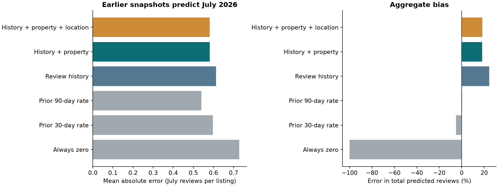

## Earlier snapshots forecasting later review activity

Historical review files for December 2025, March 2026 and June 2026 were downloaded from [Inside Airbnb](https://insideairbnb.com/get-the-data/) on 11 November 2026. Together with the supplied September reviews, these permit features and outcomes to be obtained from different dated snapshots. This is a separate forecasting experiment; the earlier price and rolling-review results retain their original definitions.

### Forecast timing and observed outcomes

The first full calendar month after each source batch finishes is the target. All source attributes and review counts precede its forecast origin; the follow-up snapshot begins after that target month ends.

| Role | Source listing/review snapshot | Latest source capture | Target month | Follow-up snapshot | Source listings | Outcomes observed | Outcomes missing |
| --- | --- | --- | --- | --- | --- | --- | --- |
| Training | December 2025 | 5 January 2026 | February 2026 | March 2026 | 82,045 | 34,329 | 47,716 |
| Validation | March 2026 | 2 April 2026 | May 2026 | June 2026 | 38,075 | 34,285 | 3,790 |
| Test | June 2026 | 29 June 2026 | July 2026 | September 2026 | 77,679 | 71,588 | 6,091 |

A source listing absent from follow-up has a missing outcome and is excluded from scoring. It is never assigned zero reviews. For a listing observed at follow-up, zero means no retained review record dated in the target month. It does not mean zero stays. The March coverage reduction means many February outcomes are unobserved; this can change the training population substantially.

The models use recent review counts over 30, 90 and 365 days, total review count, time since first/last review and age of the captured information. A second specification adds capacity, bedrooms, beds, bathrooms, minimum stay, room type, source-time superhost status and review rating. A third adds coordinates and arrondissement. Prices are excluded because every December price is missing. Review windows end at each listing's own capture date, so the rate baselines use the most recent information available in that file, not a complete window ending on the forecast origin.

Poisson gradient boosting compares 8 and 20 leaves using February training and May validation data. The selected complexity is shared across feature sets. The models are refitted on February and May before evaluating July; July does not select hyperparameters. Listings and hosts may recur over time: this evaluates future activity for previously observed properties, not generalization to unseen hosts. The prepared panel keeps missing outcomes visible for auditing.

### Results: the simple baseline remains competitive

The test contains **71,588 listings and 52,134 retained July reviews**.

| Model | MAE, reviews per listing | RMSE, reviews per listing | Error in total reviews |
| --- | --- | --- | --- |
| Always zero | 0.7283 | 1.7403 | −100.00% |
| Prior 30-day rate | 0.5974 | 1.2966 | −4.98% |
| **Prior 90-day rate** | **0.5403** | 1.1264 | **+0.26%** |
| Boosting: review history | 0.6133 | 1.0894 | +24.58% |
| Boosting: history + property | 0.5821 | **1.0794** | +18.30% |
| Boosting: history + property + location | 0.5820 | 1.0805 | +18.51% |

The 90-day baseline predicts the retained review count in the preceding 90 days multiplied by 31/90. It has the lowest mean absolute error and the closest aggregate total. The full boosting model has about **7.7% higher MAE** than this baseline. Boosting reduces RMSE, suggesting a different trade-off for larger errors, but overpredicts total activity. Adding location to historical and property features changes MAE by only about 0.00015 reviews per listing; that tiny difference is not evidence of a dependable benefit.

This finding does not invalidate the earlier 8.6% gain in the rolling survivor-cohort experiment. It shows that the gain does not transfer automatically to a different cohort, forecast design and test period. There is no universal superiority of boosting here. The 90-day rate is the strongest candidate on the chosen MAE metric in this test; another untouched future month is needed before treating that choice as established.

### Cleaning, reproducibility and limits

Ambiguous review IDs, exact duplicate records and reviews after their own listing's capture date are excluded separately in each snapshot. December loses 210 ambiguous-ID rows and 291 unmatched/post-capture rows; March loses 5,701 unmatched/post-capture rows; June loses none under these checks. September loses 42,347 ambiguous-ID rows. Full counts are in `results/historical_review_audit.csv`. Different cleaning losses and later deletion of reviews can affect measured outcomes.

Source URLs, acquisition dates and file hashes are in `results/historical_review_manifest.json`. The notebook contains the cleaning and fitting implementation. Prepared predictors, missing-outcome indicators, predictions and metrics are supplied so the experiment can be rerun without downloading the large raw review files.

Only three nonconsecutive target months are available. Uneven source coverage, follow-up selection, differing information ages and temporal distribution changes remain material limitations. No multi-year stability or annual demand forecast has been validated. Reviews remain an activity proxy; actual bookings and earnings still require direct outcome data.
